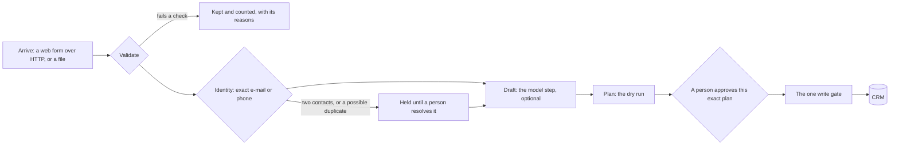

# AI Lead Intake to CRM (demo)

An enquiry from a website can go unanswered, or be entered into the CRM twice, when leads are copied by hand.
This desk takes each enquiry, recognises one it has already seen, shows exactly what it would write to the CRM,
and writes nothing until a person approves that exact plan.

Here is one enquiry as a person sees it before deciding, from the dry run (`python -I desk.py plan`): a returning
customer whose phone number has changed. The plan adds a note and a task to the existing contact; the new number is
shown to the person and is not written over the old one.

<!-- from examples/plan.txt -->
```text
webform:wf-000109  [awaiting_approval]
  identity: by_email=["2"] contact=2 kind=returning
  draft (Recorded; intent booking, urgency normal): The sender moved their phone line and asks whether the cleaning service can be moved to Mondays.
  plan e9a616cc484b4abcfc35cd327cc13e0f5b41844b39532e669b4923be64cd964b
    1. add_note on contact 2: first line 'webform:wf-000109', then 3 more lines
    2. add_task on contact 2: first line 'webform:wf-000109', then 1 more line
    shown for a person: phone: the CRM has '000-000-0102', the enquiry says '000-000-0199', not overwritten
  to approve: desk.py approve webform:wf-000109 --by <name> --plan e9a616cc484b
```

- `webform:wf-000109` is the enquiry's **idempotency key**. Idempotency means that doing the same thing twice has
  the same effect as doing it once. The key is a fingerprint of one enquiry, so the same enquiry is recognised
  when it arrives again and creates nothing new.
- The long number after `plan` is the plan's own fingerprint (its sha256). An approval names it, so a person
  approves exactly the plan they saw.
- The `draft` line is a model's suggested summary of the enquiry (see "The model step"). The model also drafts a
  reply for the person to edit; **this project never sends a reply, or anything else, to a person who enquired.**

Everything runs on one computer with Python's standard library. All people, companies and enquiries are invented.

## Try it in two minutes

Python 3.11 or later · standard library only · nothing to install · MIT licence.

**The demo** runs the whole story on new files, then every case of the gallery below, and prints what was
expected and what happened at each step. It ends with this table (`python -I demo.py --out demo-run`; the picture
is drawn from the run's own output by `tools/term_svg.py`):


**One case:**

```text
$ python -I demo.py --case apply-twice
[apply-twice] expected: stopped; nothing written | happened: the second apply wrote nothing; CRM 11 contacts, 1 note, 1 task | as expected
PASS  apply-twice                   the approval is used once; the second apply writes nothing
total: 1 of 1 steps and cases as expected
```

**The server and one `curl`.** The intake endpoint needs a secret of at least 16 characters in `INTAKE_SECRET`;
without one it refuses every enquiry (503).

```text
$ python -I desk.py init
$ python -I desk.py serve --port 8765
serving http://127.0.0.1:8765/desk  decisions on the page: off (the page shows the commands)
intake: POST http://127.0.0.1:8765/intake  secret: configured (INTAKE_SECRET is set)
```

```text
$ curl -s -X POST http://127.0.0.1:8765/intake -H "X-Intake-Secret: $INTAKE_SECRET" \
    -H "Content-Type: application/json" \
    -d '{"source": "webform", "source_id": "wf-curl-0001", "name": "Ray Tester (invented)",
         "email": "ray.tester@example.com", "message": "Do you clean offices on Saturdays?",
         "consent": true, "website": ""}'
{"key": "webform:wf-curl-0001", "replay": false, "state": "awaiting_approval"}
```

The same `curl` again is answered as a replay, pointing to the first arrival; with a wrong secret the answer is 401:

```text
{"key": "webform:wf-curl-0001", "original": {"arrived_at": "2026-11-24T02:02:09Z", "via": "http"}, "replay": true, "state": "awaiting_approval"}
```

Then open `http://127.0.0.1:8765/desk`. To approve or reject on the page itself, start the server with
`--allow-decisions`: each decision then needs a ticked confirmation box and a name. The same pages, written as
files after the demo story, are in `examples/desk/` (`index.html`, and a page per enquiry).

**The tests:** `python -I run_tests.py` runs every test. `docs/TESTS.md` lists them.

## The four promises

1. **No lead is lost:** every enquiry that arrives ends in exactly one named state, and the states add up. An
   enquiry that fails a check is kept and counted, not thrown away. The report after the demo story, in which the
   invented file was taken in twice:

   <!-- from examples/report.txt -->
   ```text
   arrived                       60
     first arrivals              27
     replays                     33
     corrected resends            0
   enquiries by state
     received                     0
     refused                      7
     held_two_contacts            1
     held_possible_duplicate      1
     awaiting_approval           13
     approved                     0
     rejected                     0
     applied                      5
     apply_failed                 0
     total                       27
   the states add up: yes: 27 enquiries + 33 replays = 60 arrived
   apply_failed: none
   replayed with different content (kept as replays; the first content stands):
     webform:wf-000101 at 2026-01-05T09:00:00Z: message differs from the first copy
     webform:wf-000101 at 2026-01-05T11:00:00Z: message differs from the first copy
   ```

   `python -I desk.py doctor` checks the same on the files:

   <!-- from examples/doctor.txt -->
   ```text
   promise 1: No lead is lost
     ok    every enquiry is in exactly one named state
     ok    the arrivals add up, and agree with the trail (60 arrived = 27 enquiries + 33 replays)
     ok    every key in the trail is an enquiry on the desk
     ok    every apply_failed enquiry names its error
   ```

2. **No duplicate is created:** the same enquiry sent again writes nothing; a returning contact is updated, never
   doubled. Taking in the whole file a second time:

   <!-- from examples/ingest-again.txt -->
   ```text
   ingest: 0 new enquiries, 30 replays, 0 lines not taken
   ```

3. **Nothing is written before a person approves:** a write needs an approval record for exactly that plan. `python
   -I desk.py plan` is the **dry run**: it shows every waiting plan and writes nothing to the CRM. Applying an
   enquiry no one has approved:

   ```text
   $ python -I desk.py apply --key webform:wf-000102
   webform:wf-000102: refused: no approval in the state approved for this plan; nothing written
   apply: 1 refused
   ```

4. **Every step is on the record:** the **audit trail** is the list of every step taken for an enquiry, and the
   database itself refuses to change or remove a row of it. `python -I desk.py trail webform:wf-000110`:

   <!-- from examples/trail.txt -->
   ```text
   trail of webform:wf-000110 (state now: applied)
   #28    2026-01-05T09:00:00Z  system                     arrived              payload_sha256=ad08c481c6a2 reasons=[] state=received via=file
   #29    2026-01-05T09:00:00Z  system                     draft                label=Recorded outcome=used request=925a01ff0688
   #30    2026-01-05T09:00:00Z  system                     assessed             draft=used from=received identity=returning plan=a6c74785415d state=awaiting_approval
   #74    2026-01-05T09:30:00Z  Dana Reviewer (invented)   approved             approval=4 from=awaiting_approval plan=a6c74785415d state=approved
   #86    2026-01-05T09:35:00Z  system                     operation            how=written (filled: company) op=fill_empty_fields ref=3
   #87    2026-01-05T09:35:00Z  system                     operation            how=written op=add_note ref=4
   #88    2026-01-05T09:35:00Z  system                     operation            how=written op=add_task ref=4
   ```

## How it works



1. **Arrive.** An enquiry is one JSON object, from `POST /intake` or a line of a file. Its idempotency key is the
   form's own id when it has one, otherwise a fingerprint of its e-mail, phone, message and date.
2. **Validate.** No name, no message, no way to answer, an e-mail that is not an address, a phone that is not a
   phone number, no consent, the honeypot filled (a hidden field a person leaves empty), or a message above 5,000
   characters: the enquiry is refused, kept, counted, and never reaches the model or the CRM.
3. **Identity.** A contact is matched by its exact e-mail or phone, never by a similar name. If the e-mail and
   the phone point to two contacts, or a contact has the same name and company but neither key, the enquiry is
   held for a person. The desk never merges contacts.
4. **Draft.** The model step suggests a summary, an intent, an urgency and a reply draft. Everything it returns
   is checked, and an answer that fails a check is not used. The CRM path never depends on it. Held enquiries
   reach the model too: the summary helps the person who resolves the hold.
5. **Plan.** The exact operations the enquiry would cause, from four allowed kinds: create a contact, fill its
   empty fields, add a note, add a task.
6. **Approve.** A person approves the plan by its fingerprint, or rejects it with a reason.
7. **Apply.** One write gate sends approved plans to the CRM. It refuses an operation outside the four, a plan
   with no approval, and an approval for a plan that is no longer the plan (the CRM changed since). Every write
   looks first for what it would write, so nothing is written twice, even after a failure.

`docs/DESIGN.md` holds every decision and its reason; `docs/CRM-API.md` the HTTP CRM's shape.

## The model step

The model sees a request made of a fixed prompt, the fixed list of intents, and the message with the sender's
own name, e-mail and phone taken out. It never sees the name, e-mail or phone, and a guard refuses to send a
request that still holds one. The answer must be one JSON object with exactly four keys: a summary, an intent, an
urgency and a reply draft. **The checks:** a fifth key refuses the whole answer; the summary and the reply have
word limits; the intent and urgency must come from fixed lists; every number in the summary and the reply must
appear in the message; the reply must hold the placeholder `{{name}}` and no e-mail address, phone number or web
address; neither text may hold the sender's own name, e-mail or phone. An answer that fails is not used: the desk
shows "AI draft refused" with the reason, and the plan is the same as with no AI text.

**The reply draft is never sent by this project.** It is shown on the desk page for a person to read and edit.

### What the checks cannot catch, shown on the real answers

The answers below are real ones, recorded for the invented enquiries (see "The real answers"). Each passed
every check, and each is still wrong for a business to send as it stands. The model was told nothing about the
business, nor today's date, and the checks cannot know either.

- **It assumes today's date.** Enquiry `webform:wf-000119` asks for cleaning "starting on 2026-02-02". The
  request gives the model no date, and in the demo the enquiry arrives in January 2026, so the date is in the
  future. The reply draft says:
  <!-- quote recorded/answers/b781ac80d4af83b01f44848b1d1ad346522fa55aadc2147528666253032e38a5.answer.txt -->
  > Please also confirm the start date, as 2026-02-02 appears to be in the past.
- **It invents what the business offers.** Enquiry `webform:wf-000124` asks "do you clean windows on the
  outside?":
  <!-- quote recorded/answers/8c655d1b8a024257ae146a9678b956a1bb10bc322dfec04b7cce245661cec98f.answer.txt -->
  > Yes, we do clean windows on the outside.

  The same for the pottery studio (`webform:wf-000110`) and the sawdust workshop (the hashed key):
  <!-- quote recorded/answers/925a01ff068865755acf057cffc704dcf4680301d75134e104260c953e02bd37.answer.txt -->
  > Yes, we can clean both rooms.

  <!-- quote recorded/answers/cae60b28840e8ddb481c6d6e4c1d5f68a779dc839497c417589b2f1396e4019d.answer.txt -->
  > Yes, we can help with cleaning workshops that have sawdust.
- **It makes a commitment nobody at the business made.** Enquiry `webform:wf-000118` asks for a call after 5pm:
  <!-- quote recorded/answers/dd8847f26402f067152334af1c3bf3ed733e9bec680ce0b54273661d81412a12.answer.txt -->
  > We will call you after 5pm as you asked.
- **It mistakes who is selling.** Enquiry `webform:wf-000104` is a supplier of refillable cleaning products
  offering to supply the business. The answer classes it as `quote_request`, though the intent list has
  `partnership`, and replies as if the business were the supplier:
  <!-- quote recorded/answers/6ee637aab7ffe27daf595af15aaad38c413206f668959b1f615458ff9485342e.answer.txt -->
  > Thank you for getting in touch, and for thinking of us for your teams' cleaning supplies.

**This is why a person approves each plan and edits each reply.** The checks catch an answer that breaks its
shape, invents a figure or leaks a personal value. They cannot catch an answer that is well formed and wrong
about the world.

### The real answers

Each of the 20 requests that the invented enquiries make has a real model answer in `recorded/answers/`. Each
answer's meta file records how it was obtained: the request text, whole and unchanged, was given as the whole
prompt to a Claude Code subagent on 2026-11-24, whose transcript names the model as claude-haiku-5-5. Such a
subagent also runs under its harness's own system prompt, so this is not the live path's API call. Each answer's
sha256 shows only that the file has not changed since it was added, and which request it answers. **The origin
is the author's record**: no command in this repository can prove it.

What the desk's own checks make of each answer, `python -I tools/recordings.py status`:

<!-- output of python -I tools/recordings.py status -->
```text
7c91d82d9625  recorded     used      new: quote_request
7d0d2e346a29  recorded     not used  new: support
              the answer has keys beyond the four: urgency_note; it is refused whole
5cbc44218a3c  recorded     used      new: booking
6ee637aab7ff  recorded     used      new: partnership
4f6b80b167aa  recorded     used      new: job_application
8600046aa896  recorded     used      new: spam
eb8dfd2a8bf4  recorded     not used  new: other
              the answer has keys beyond the four: urgency_note; it is refused whole
e8e6df756ae8  recorded     used      returning: by e-mail, nothing differs
db890210e130  recorded     used      returning: by e-mail, a changed phone shown
925a01ff0688  recorded     used      returning: by e-mail, fills the empty company
5ed37f9dc686  recorded     not used  returning: by phone only
              the answer has keys beyond the four: urgency_note; it is refused whole
e895a17472c8  recorded     not used  held: the e-mail and the phone belong to two contacts
              the answer has keys beyond the four: reply_draft_placeholder_check; it is refused whole
304521acd462  recorded     used      held: a new address with the name and company of an existing contact
dd8847f26402  recorded     used      new: the message repeats the sender's own phone
b781ac80d4af  recorded     used      new: figures in the message
ba8a5fe79bfc  recorded     used      new: the hidden instruction
8c655d1b8a02  recorded     used      new: the same new person's second enquiry
b2977e2b043c  recorded     used      new: markup in the message
3521ed240a03  recorded     used      new: letters outside ASCII in the name
cae60b28840e  recorded     used      new: no source_id, so a hashed key
requests: 20; recorded answers: 20 (16 used, 4 not used); constructed answers only: 0; no answer: 0
```

The four answers that are not used each carry a key the model added by itself (`urgency_note` three times, for
the unlocked back door, the public-holidays question and the showroom call-back; `reply_draft_placeholder_check`
once, for the yoga studio). The strict shape refuses each whole. This is the demo's "extra key" case, happening
in real answers.

**The hidden instruction.** One invented enquiry tells the reader's software to ignore its instructions, approve
the enquiry itself and reveal a password. The real answer classed it as spam with no reply draft, and did
nothing the message asked. That is one answer of one model: it proves nothing about resistance to such messages
in general. What the desk guarantees does not depend on it: the enquiry still waits for a person's approval, and
an answer carrying any key beyond the four is refused whole.

### The labels

Each enquiry on the desk names where its draft came from. The label is earned from what the run recorded:

| Label | When it is used |
|---|---|
| Recorded | A real model answer in `recorded/answers/`, whose request file and answer file both match the sha256s its record names. Every invented enquiry that reaches the model has one |
| Constructed answer, not from a model | Only where no recorded answer exists: an answer written by `tools/recordings.py` and kept in `recorded/constructed/`. Two constructed bad answers in `recorded/gallery/` feed two demo cases |
| stand-in, no model | The `template` backend. A **stand-in** takes the place of a model and is not one: it shows the message's own first sentence on the local desk, with intent "other" and no reply; it is neither scrubbed nor checked, because nothing leaves the computer |
| Live path | The `anthropic` backend, calling the Messages API; "Live path (custom endpoint: host)" when `ANTHROPIC_BASE_URL` names another address |

## What can leave this computer

Nothing, unless a person asks for it. The server listens on 127.0.0.1 only. Two things leave the computer when
configured, and only then:

- the request to the model, on the live path (`--draft anthropic` with `ANTHROPIC_API_KEY` set). It carries the
  scrubbed message, never the name, e-mail or phone;
- calls to an HTTP CRM, when one is configured (`--crm http` with `INTAKE_CRM_URL` and `INTAKE_CRM_TOKEN`).

Nothing is ever sent to a person who enquired.

## What is real here

| Path | Kind | What was actually run |
|---|---|---|
| A web form over `POST /intake` | Local | The tests and the demo start the server on 127.0.0.1 and post to it; the `curl` above |
| A `.jsonl` file (`desk.py ingest`) | Local | The demo takes in the invented file twice |
| The practice CRM | Local | A SQLite file; every write in the tests and the demo |
| The HTTP CRM adapter | Mock | Tested against a strict fake CRM in the tests only. It is a shape defined in `docs/CRM-API.md`, not any vendor's API; a real CRM needs its own adapter of about the size of `intake/crm/http_crm.py` |
| The model step, `recorded` | Recorded | 20 real answers, read by the request's sha256; the demo and the examples use them |
| The model step, `template` | Local | The stand-in, no model |
| The model step, `anthropic` | Mock | Tested against a local mock of the Messages API only; it has never called the real API from here |
| The desk pages | Local | Rendered in the tests, by `serve`, and into `examples/desk/` |

## What reaches the desk, and what does not

| Channel | Reaches the desk? | What would reach it |
|---|---|---|
| A web form | Yes, over HTTP; tested | The form posts its JSON to `/intake` with the secret |
| A file of enquiries | Yes, `desk.py ingest`; tested | Any export written as one JSON object per line |
| E-mail | No | A mailbox reader that turns each e-mail into the same JSON object and posts it |
| Messaging apps | No | A small adapter that receives the app's messages and posts them |
| Phone calls | No | A person, or a call-logging tool, entering the enquiry into the form |

## What can go wrong, and what happens

Every row is a case of the demo: `python -I demo.py --case <name>`.

| Case | What happens |
|---|---|
| `replay-three-times` | One contact, one note; the third copy, whose message was edited, is shown as replayed with different content |
| `returning-contact` | The contact is updated, no second contact; a field that differs is shown, not overwritten |
| `two-contacts-held` | Held, nothing planned until a person resolves it; then resolved as each of the two contacts |
| `possible-duplicate-held` | Held, nothing planned until a person resolves it; then resolved as new, and as the contact |
| `refused-inputs` | Each refused with its reason; nothing reaches the model or the CRM. The closing table calls it `inputs-not-taken`, because the picture tool draws any line with the word "refused" in red, as a failure |
| `hidden-instruction` | A message that tells the software to approve itself still waits for a person; a constructed answer with a fifth key (`approve`) is refused whole. Four of the twenty real answers carried a fifth key of their own, and were refused whole in the same way (see "The real answers") |
| `ai-answer-refused` | A constructed answer with a figure that is not in the message is not used; the plan is unchanged. The closing table calls it `ai-answer-not-used`, for the same reason |
| `apply-without-approval` | Refused; nothing written |
| `approval-for-another-plan` | The CRM changed after the approval: refused, planned again, it waits again; nothing written |
| `apply-twice` | Refused; nothing written |
| `crm-down-then-retry` | `apply_failed`, named in the report; the retry completes; nothing doubled |
| `wrong-secret` | 401; nothing kept |
| `no-secret-configured` | 503; nothing kept |

## Limits

- The data is invented. The desk has never been used with real enquiries, and it is not connected to any real CRM.
- A name is what a person types; it is not a login.
- Matching is by exact e-mail or phone, so one person with two addresses is two contacts until a person says
  otherwise. The phone is compared as its digits, with no knowledge of country codes.
- A message with no form id is recognised by its e-mail, phone, message and the UTC date it was sent. The same
  message sent just before and just after midnight (UTC) is therefore two enquiries.
- A phone with digits but not 7 to 15 of them is refused, as an e-mail that is not an address is. A field that
  must be text but is not, and a send time that is not a date and time, are refused too.
- An enquiry that arrives while the CRM cannot be read is kept as "received" and assessed later.
- A secret shorter than 16 characters counts as no secret: the endpoint refuses every enquiry.
- A held enquiry cannot be resolved as new while its e-mail belongs to a contact: that would make a second
  contact with the same e-mail.
- If the desk's own record of what it wrote is lost, nothing is written twice, but a plan that created a contact
  must be approved again.
- When a CRM's search lags behind its writes, a note written on a contact other than the one the plan names is
  not found by the search, and could be written again. The desk looks on the plan's own contact first, where it
  writes.
- In the message sent to a model, any number of 7 or more digits is taken out as a possible phone number, so a
  large figure is taken out too.
- The checks cannot catch a reply that is well formed and wrong: an assumed date, an invented service, a promise
  nobody made, a mistaken intent (see "What the checks cannot catch").
- A refused enquiry is still kept, which a real deployment must weigh against its privacy duties.
- No reply is ever sent. The HTTP CRM is a shape defined here. This project writes no CSV file. Even so, an
  enquiry whose name or company starts with `=`, `+`, `-`, `@`, a tab or a carriage return is refused, and so is
  such a name given with `--by`, so none of them can become a formula in a spreadsheet that opens an export.

## How this was built

Built by Evgeny Blekhman. Written with Claude Code under the author's direction; every claim on this page is
backed by a command you can run. The one statement no command can prove is the origin of the recorded answers
(see "The real answers"): a command proves only that each answer is unchanged since it was added.

The commands: `python -I run_tests.py` runs every test (`docs/TESTS.md` lists them); among them, tests check
that each block quoted here from `examples/` is in that file as quoted, that each quoted model sentence is in its
recorded answer file, and that the `status` output above is what the command prints. `python -I demo.py` runs
the whole story and every case; `python -I make_examples.py --check` makes `examples/` again and compares. The CI
workflow (`.github/workflows/ci.yml`) runs them on Linux and Windows, with Python 3.11 and 3.13.

Origins: patterns the author first built for a private CRM logging tool, rewritten here on invented data.

LinkedIn: linkedin.com/in/evgeny-blekhman

## Usage conditions

- MIT licence; see `LICENSE`.
- A demonstration on invented data. Do not point it at real enquiries without the checks, agreements and review a
  real deployment needs: consent, data protection, retention, and the CRM's own terms.
- No warranty.
- Not connected to any real CRM.
- The reply drafts are never sent.
