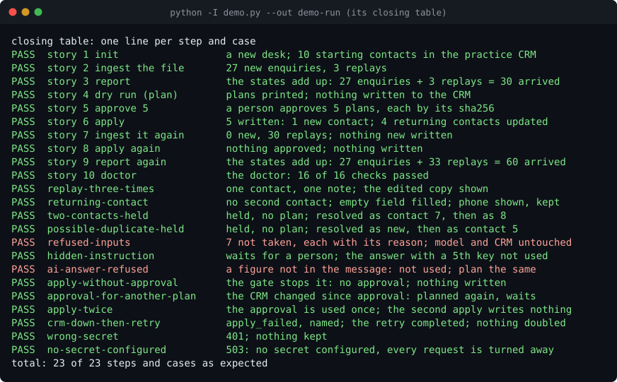
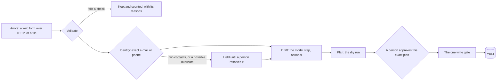

# AI Lead Intake to CRM (demo)

An enquiry from a website can go unanswered, or be entered into the CRM twice, when leads are copied by hand.
This desk takes each enquiry, recognises one it has already seen, shows exactly what it would write to the CRM,
and writes nothing until a person approves that exact plan.

Everything here runs on one computer with Python's standard library. All people, companies and enquiries are
invented, and **nothing is ever sent to a person who enquired**: the desk drafts a reply for a person to read,
and never sends it.

## What you see

One enquiry as the desk shows it, from the dry run (`python -I desk.py plan`): a returning customer whose phone
number has changed. The plan adds a note and a task to the existing contact; the new number is shown for a person
and is not written over the old one. The draft above the plan comes from the model step; this one is labelled as a
constructed answer, because no real model answer has been recorded for it yet.

<!-- from examples/plan.txt -->
```text
webform:wf-000109  [awaiting_approval]
  identity: by_email=["2"] contact=2 kind=returning
  draft (Constructed answer, not from a model): We moved our phone line.
  plan e9a616cc484b4abcfc35cd327cc13e0f5b41844b39532e669b4923be64cd964b
    1. add_note on contact 2: first line 'webform:wf-000109', then 3 more lines
    2. add_task on contact 2: first line 'webform:wf-000109', then 1 more line
    shown for a person: phone: the CRM has '000-000-0102', the enquiry says '000-000-0199', not overwritten
  to approve: desk.py approve webform:wf-000109 --by <name> --plan e9a616cc484b
```

`webform:wf-000109` is the enquiry's **idempotency key**: a fingerprint of one enquiry, so that the same one is
recognised when it arrives again. The long number after `plan` is the plan's own fingerprint (its sha256): an
approval names it, so a person approves exactly the plan they saw.

The report after the whole demo story, in which the invented file was taken in twice:

<!-- from examples/report.txt -->
```text
arrived                       60
  first arrivals              27
  replays                     33
enquiries by state
  received                     0
  refused                      7
  held_two_contacts            1
  held_possible_duplicate      1
  awaiting_approval           13
  approved                     0
  rejected                     0
  applied                      5
  apply_failed                 0
  total                       27
the states add up: yes: 27 enquiries + 33 replays = 60 arrived
apply_failed: none
replayed with different content (kept as replays; the first content stands):
  webform:wf-000101 at 2026-01-05T09:00:00Z: message differs from the first copy
  webform:wf-000101 at 2026-01-05T11:00:00Z: message differs from the first copy
```

The desk is also a web page on this computer (`python -I desk.py serve`), and the same pages can be written as
files: `examples/desk/index.html` is the desk after the demo story, with a page per enquiry beside it.

## Try it in two minutes

Python 3.11 or later · standard library only · nothing to install · MIT licence.

**The demo** runs the whole story on new files, then every case of the gallery below, and prints what was
expected and what happened at each step. It ends with this table (`python -I demo.py --out demo-run`; the picture
is drawn from the run's own output by `tools/term_svg.py`):



**One case:**

```text
$ python -I demo.py --case apply-twice
[apply-twice] expected: stopped; nothing written | happened: the second apply wrote nothing; CRM 11 contacts, 1 note, 1 task | as expected
PASS  apply-twice                   the approval is used once; the second apply writes nothing
total: 1 of 1 steps and cases as expected
```

**The server and one `curl`.** The intake endpoint needs a secret of at least 16 characters in `INTAKE_SECRET`;
without one it refuses every enquiry (503).

```text
$ python -I desk.py init
$ python -I desk.py serve --port 8765
serving http://127.0.0.1:8765/desk  decisions on the page: off (the page shows the commands)
intake: POST http://127.0.0.1:8765/intake  secret: configured (INTAKE_SECRET is set)
```

```text
$ curl -s -X POST http://127.0.0.1:8765/intake -H "X-Intake-Secret: $INTAKE_SECRET" \
    -H "Content-Type: application/json" \
    -d '{"source": "webform", "source_id": "wf-curl-0001", "name": "Ray Tester (invented)",
         "email": "ray.tester@example.com", "message": "Do you clean offices on Saturdays?",
         "consent": true, "website": ""}'
{"key": "webform:wf-curl-0001", "replay": false, "state": "awaiting_approval"}
```

The same `curl` again is answered as a replay, pointing to the first arrival; with a wrong secret the answer is 401:

```text
{"key": "webform:wf-curl-0001", "original": {"arrived_at": "2026-11-24T02:02:09Z", "via": "http"}, "replay": true, "state": "awaiting_approval"}
```

Then open `http://127.0.0.1:8765/desk`. To approve or reject on the page itself, start the server with
`--allow-decisions`: each decision then needs a ticked confirmation box and a name.

**The tests:** `python -I run_tests.py` runs every test. `docs/TESTS.md` lists them.

## The four promises

1. **No lead is lost:** every enquiry that arrives ends in exactly one named state, and the states add up. An
   enquiry that fails a check is kept and counted, not thrown away. `python -I desk.py report` says whether the
   states add up (above), and `python -I desk.py doctor` checks it on the files:

   <!-- from examples/doctor.txt -->
   ```text
   promise 1: No lead is lost
     ok    every enquiry is in exactly one named state
     ok    the arrivals add up (60 arrived = 27 enquiries + 33 replays)
     ok    every key in the trail is an enquiry on the desk
     ok    every apply_failed enquiry names its error
   ```

2. **No duplicate is created:** the same enquiry sent again writes nothing; a returning contact is updated, never
   doubled. Taking in the whole file a second time:

   <!-- from examples/ingest-again.txt -->
   ```text
   ingest: 0 new enquiries, 30 replays, 0 lines not taken
   ```

3. **Nothing is written before a person approves:** a write needs an approval record for exactly that plan. `python
   -I desk.py plan` is the **dry run**: it shows every waiting plan and writes nothing to the CRM. Applying an
   enquiry no one has approved:

   ```text
   $ python -I desk.py apply --key webform:wf-000102
   webform:wf-000102: refused: no approval in the state approved for this plan; nothing written
   apply: 1 refused
   ```

4. **Every step is on the record:** the **audit trail** is the list of every step taken for an enquiry, and the
   database itself refuses to change or remove a row of it. `python -I desk.py trail webform:wf-000110`:

   <!-- from examples/trail.txt -->
   ```text
   trail of webform:wf-000110 (state now: applied)
   #28    2026-01-05T09:00:00Z  system                     arrived              reasons=[] state=received via=file
   #29    2026-01-05T09:00:00Z  system                     draft                label=Constructed answer, not from a model outcome=used request=925a01ff0688
   #30    2026-01-05T09:00:00Z  system                     assessed             draft=used from=received identity=returning plan=a6c74785415d state=awaiting_approval
   #74    2026-01-05T09:30:00Z  Dana Reviewer (invented)   approved             approval=4 from=awaiting_approval plan=a6c74785415d state=approved
   #86    2026-01-05T09:35:00Z  system                     operation            how=written (filled: company) op=fill_empty_fields ref=3
   #87    2026-01-05T09:35:00Z  system                     operation            how=written op=add_note ref=4
   #88    2026-01-05T09:35:00Z  system                     operation            how=written op=add_task ref=4
   ```

## How it works



1. **Arrive.** An enquiry is one JSON object, from `POST /intake` or a line of a file. Its idempotency key is the
   form's own id when it has one, otherwise a fingerprint of its e-mail, phone, message and date.
2. **Validate.** No name, no message, no way to answer, an e-mail that is not an address, a phone that is not a
   phone number, no consent, the honeypot filled (a hidden field a person leaves empty), or a message above 5,000
   characters: the enquiry is refused, kept, counted, and never reaches the model or the CRM.
3. **Identity.** A contact is matched by its exact e-mail or phone, never by a similar name. If the e-mail and
   the phone point to two contacts, or a contact has the same name and company but neither key, the enquiry is
   held for a person. The desk never merges contacts.
4. **Draft.** The model step suggests a summary, an intent, an urgency and a reply draft. Everything it returns
   is checked, and an answer that fails a check is not used. The CRM path never depends on it.
5. **Plan.** The exact operations the enquiry would cause, from four allowed kinds: create a contact, fill its
   empty fields, add a note, add a task.
6. **Approve.** A person approves the plan by its fingerprint, or rejects it with a reason.
7. **Apply.** One write gate sends approved plans to the CRM. It refuses an operation outside the four, a plan
   with no approval, and an approval for a plan that is no longer the plan (the CRM changed since). Every write
   looks first for what it would write, so nothing is written twice, even after a failure or a lost record.

`docs/DESIGN.md` holds every decision and its reason; `docs/CRM-API.md` the HTTP CRM's shape.

## The model step and its labels

The model sees a request made of a fixed prompt, the fixed list of intents, and the message with the sender's
own name, e-mail and phone taken out. It never sees the name, e-mail or phone, and a guard refuses to send a
request that still holds one. The answer must be one JSON object with exactly four keys; a fifth key refuses the
whole answer. Every number in its summary and reply must appear in the message; the reply must hold the
placeholder `{{name}}` and no e-mail address, phone number or web address.

Each enquiry on the desk names where its draft came from. The label is earned from what the run recorded:

| Label | When |
|---|---|
| Recorded | A real model answer in `recorded/answers/`, whose request file and answer file both match the sha256s its record names |
| Constructed answer, not from a model | An answer written by `tools/recordings.py`, kept in `recorded/constructed/` |
| stand-in, no model | The `template` backend: the first sentence of the message, intent "other", no reply. A **stand-in** takes the place of a model and is not one |
| Live path | The `anthropic` backend, calling the Messages API; "Live path (custom endpoint: host)" when `ANTHROPIC_BASE_URL` names another address |

**The recorded answers' origin is the author's statement.** They are obtained by giving a Claude Code subagent
each request text as its whole prompt. Such a subagent runs under its own system prompt, so it is not the same
call the live backend would make. The repository cannot prove where an answer came from: each sha256 proves only
that the file has not changed since it was saved, and which request it answers. In this version no real answer
is recorded yet: `python -I tools/recordings.py status` lists every request and what it has.

## What can leave this computer

Nothing, unless a person asks for it. The server listens on 127.0.0.1 only. Two things leave the computer when
configured, and only then:

- the request to the model, on the live path (`--draft anthropic` with `ANTHROPIC_API_KEY` set). It carries the
  scrubbed message, never the name, e-mail or phone;
- calls to an HTTP CRM, when one is configured (`--crm http` with `INTAKE_CRM_URL` and `INTAKE_CRM_TOKEN`).

Nothing is ever sent to a person who enquired.

## What is real here

| Path | Kind | What was actually run |
|---|---|---|
| A web form over `POST /intake` | Local | The tests and the demo start the server on 127.0.0.1 and post to it; the `curl` above |
| A `.jsonl` file (`desk.py ingest`) | Local | The demo takes in the invented file twice |
| The practice CRM | Local | A SQLite file; every write in the tests and the demo |
| The HTTP CRM adapter | Mock | Tested against a strict fake CRM in the tests only. It is a shape defined in `docs/CRM-API.md`, not any vendor's API; a real CRM needs its own adapter of about the size of `intake/crm/http_crm.py` |
| The model step, `recorded` | Recorded | Reads answers by the request's sha256. No real answer is recorded yet; until then the demo uses constructed answers, labelled so |
| The model step, `template` | Local | The stand-in, no model |
| The model step, `anthropic` | Mock | Tested against a local mock of the Messages API only; it has never called the real API from here |
| The desk pages | Local | Rendered in the tests, by `serve`, and into `examples/desk/` |

## What reaches the desk, and what does not

| Channel | Reaches the desk? | What would reach it |
|---|---|---|
| A web form | Yes, over HTTP; tested | The form posts its JSON to `/intake` with the secret |
| A file of enquiries | Yes, `desk.py ingest`; tested | Any export written as one JSON object per line |
| E-mail | No | A mailbox reader that turns each e-mail into the same JSON object and posts it |
| Messaging apps | No | A small adapter that receives the app's messages and posts them |
| Phone calls | No | A person, or a call-logging tool, entering the enquiry into the form |

## What can go wrong, and what happens

Every row is a case of the demo: `python -I demo.py --case <name>`.

| Case | What happens |
|---|---|
| `replay-three-times` | One contact, one note; the third copy, whose message was edited, is shown as replayed with different content |
| `returning-contact` | The contact is updated, no second contact; a field that differs is shown, not overwritten |
| `two-contacts-held` | Held, nothing planned until a person resolves it; then resolved as each of the two contacts |
| `possible-duplicate-held` | Held, nothing planned until a person resolves it; then resolved as new, and as the contact |
| `refused-inputs` | Each refused with its reason; nothing reaches the model or the CRM. The closing table calls it `inputs-not-taken`, because the picture tool draws any line with the word "refused" in red, as a failure |
| `hidden-instruction` | A message that tells the software to approve itself still waits for a person; an answer with an extra key is refused whole |
| `ai-answer-refused` | A constructed answer with a figure that is not in the message is not used; the plan is unchanged. The closing table calls it `ai-answer-not-used`, for the same reason |
| `apply-without-approval` | Refused; nothing written |
| `approval-for-another-plan` | The CRM changed after the approval: refused, planned again, it waits again; nothing written |
| `apply-twice` | Refused; nothing written |
| `crm-down-then-retry` | `apply_failed`, named in the report; the retry completes; nothing doubled |
| `wrong-secret` | 401; nothing kept |
| `no-secret-configured` | 503; nothing kept |

## Limits

- The data is invented. The desk has not been used with real enquiries.
- A name is what a person types; it is not a login.
- Matching is by exact e-mail or phone, so one person with two addresses is two contacts until a person says
  otherwise. The phone is compared as its digits, with no knowledge of country codes.
- A message with no form id is recognised by its e-mail, phone, message and the UTC date it was sent. The same
  message sent just before and just after midnight (UTC) is therefore two enquiries.
- A phone with digits but not 7 to 15 of them is refused, as an e-mail that is not an address is. A field that
  must be text but is not, and a send time that is not a date and time, are refused too.
- An enquiry that arrives while the CRM cannot be read is kept as "received" and assessed later.
- A secret shorter than 16 characters counts as no secret: the endpoint refuses every enquiry.
- A held enquiry cannot be resolved as new while its e-mail belongs to a contact: that would make a second
  contact with the same e-mail.
- If the desk's own record of what it wrote is lost, nothing is written twice, but a plan that created a contact
  must be approved again.
- When a CRM's search lags behind its writes, a note written on a contact other than the one the plan names is
  not found by the search, and could be written again. The desk looks on the plan's own contact first, where it
  writes.
- In the message sent to a model, any number of 7 or more digits is taken out as a possible phone number.
- A refused enquiry is still kept, which a real deployment must weigh against its privacy duties.
- No reply is ever sent. The HTTP CRM is a shape defined here. This project writes no CSV file; a name that
  starts with `=`, `+`, `-` or `@` is refused anyway, so it can never become a formula in a spreadsheet.

## How this was built

Written with Claude Code under the author's direction. The tests and the commands above show what the code does
with the invented data: the four promises, the write gate's refusals, the model step's checks, the escaping of the
pages, and every case of the demo. The CI workflow (`.github/workflows/ci.yml`) runs the tests, the whole demo and
a comparison of `examples/` on Linux and Windows, with Python 3.11 and 3.13. Every output quoted above was pasted
from a run, and a test checks that each block quoted from `examples/` is in that file as quoted.

What no test can prove: where the recorded model answers came from. That is the author's statement (see "The model
step and its labels"). A test proves only that each recorded answer is unchanged since it was saved.

Origins: patterns the author first built for a private CRM logging tool, rewritten here on invented data.

## Usage conditions

This is a demonstration on invented data. Do not point it at real enquiries without the checks, agreements and
review a real deployment needs: consent, data protection, retention, and the CRM's own terms. It comes with no
warranty, under the MIT licence.

## Licence and author

MIT; see `LICENSE`. Author: Evgeny Blekhman, https://www.linkedin.com/in/evgeny-blekhman/.
